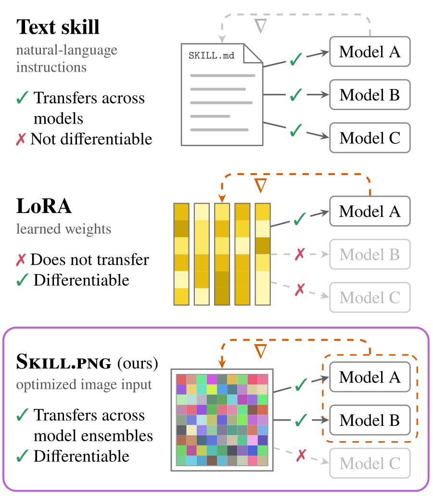
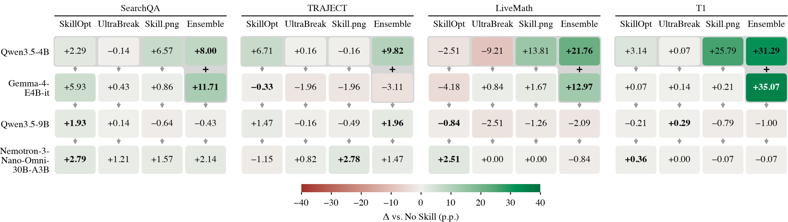
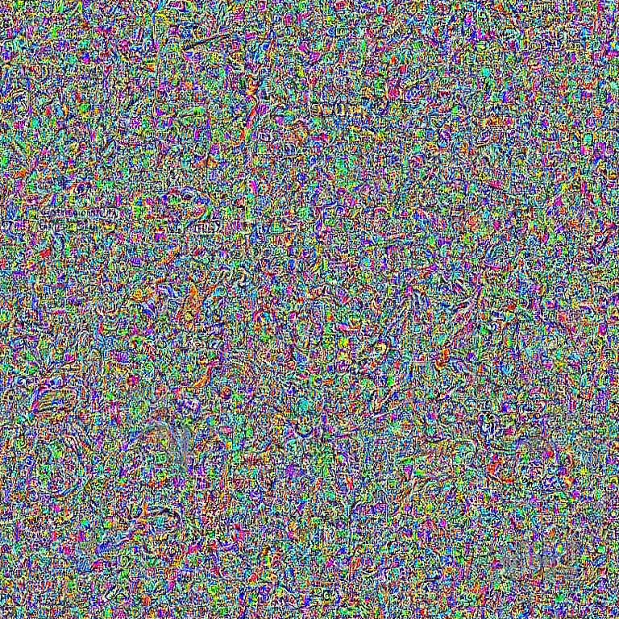
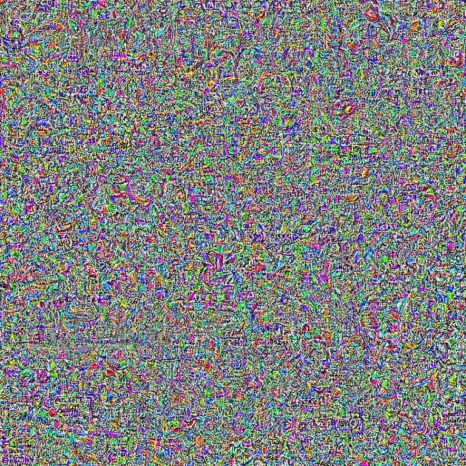

<h1 align="center">Skill.png: Learning Agent Skills in Pixel Space</h1>

<p align="center">
  <a href="pyproject.toml"></a>
  <a href="LICENSE"></a>
  <a href="https://arxiv.org/abs/2611.26296"></a>
</p>

<p align="center">
  <b>Maximilian Seeth</b><sup>1,2</sup>, <b>Chengzhi Martin Hu</b><sup>2,3</sup>, <b>Marie Kempkes</b><sup>4</sup>, <b>Paul Röttger</b><sup>1</sup>, <b>Leo Schwinn</b><sup>2,3</sup><br>
  <sup>1</sup>Hasso Plattner Institute, <sup>2</sup>Technical University of Munich,
  <sup>3</sup>Helmholtz AI, <sup>4</sup>Volkswagen Group Innovation
</p>

<p align="center">
  
</p>

A **Skill.png** is an agent skill stored as an image. Its pixels are optimized by gradient descent
through the vision encoder of a frozen vision-language model (VLM), and the finished image is
attached to the user turn like any other picture. The model's weights are never touched, and the
same image can be optimized for several VLMs at once.

- **Beats LLM-optimized text skills.** Across 4 VLMs and 4 benchmarks, Skill.png scores
  significantly higher than [SkillOpt](https://github.com/microsoft/SkillOpt) text skills in 9 of
  16 settings, and up to 37.8 points above the model without a skill.
- **Short.** One image costs 64 to 256 image tokens per query. The text skills average 937 to 1963
  tokens.
- **Combines with text.** An image optimized with a text skill already in the system prompt adds
  6.1 to 15.5 points to that skill on three of four benchmarks.
- **Transfers within an ensemble.** One image optimized jointly for Qwen3.5-4B and Gemma-4-E4B-it
  improves both. No skill image transfers to a model outside its ensemble.
- **Not legible, except to its own model.** A VLM describes its own Skill.png as noise in at most
  24% of its answers, and the images of other models in 47% to 85%.

## Contents

- [Results](#results)
- [How it works](#how-it-works)
- [Setup](#setup)
- [VLMs](#vlms)
- [Benchmarks](#benchmarks)
- [Optimizing an image](#optimizing-an-image)
- [Evaluating](#evaluating)
- [Baselines](#baselines)
- [Interpreting Skill.png](#interpreting-skillpng)
- [Layout](#layout)
- [License](#license)
- [Cite as](#cite-as)

## Results

Test scores in %, reasoning disabled, with the change from No Skill in parentheses. Bold marks the
9 settings where Skill.png beats SkillOpt significantly (two-sided exact McNemar test, p < 0.05).

| Model                        | Skill         | SearchQA           | TRAJECT        | LiveMath           | T1                 |
| ---------------------------- | ------------- | ------------------ | -------------- | ------------------ | ------------------ |
| Qwen3.5-4B                   | No Skill      | 68.79              | 25.37          | 48.54              | 24.71              |
|                              | SkillOpt      | 71.07              | 32.08          | 46.03              | 27.86              |
|                              | **Skill.png** | **75.36** (+6.57)  | 25.20 (−0.16)  | **62.34** (+13.81) | **50.50** (+25.79) |
| Gemma-4-E4B-it               | No Skill      | 61.64              | 40.26          | 49.79              | 24.71              |
|                              | SkillOpt      | 69.36              | 41.57          | 49.79\*            | 41.21              |
|                              | **Skill.png** | **71.93** (+10.29) | 40.26\*        | 55.23 (+5.44)      | **62.50** (+37.79) |
| Qwen3.5-9B                   | No Skill      | 71.07              | 47.79          | 46.03              | 27.21              |
|                              | SkillOpt      | 73.79              | 51.39          | 46.03\*            | 44.29              |
|                              | **Skill.png** | 72.14 (+1.07)      | 48.12 (+0.33)  | **58.16** (+12.13) | 44.57 (+17.36)     |
| Nemotron-3-Nano-Omni-30B-A3B | No Skill      | 65.29              | 30.93          | 54.39              | 24.79              |
|                              | SkillOpt      | 68.00              | 31.26          | 57.32              | 26.86              |
|                              | **Skill.png** | **75.79** (+10.50) | 21.11 (−9.82)  | **70.71** (+16.32) | **55.36** (+30.57) |

\* Optimization found nothing better than No Skill on validation, so the No Skill score is shown.

SkillOpt is the text skill refined by GPT-6 Luna from the target model's rollouts. The paper's
full table adds a random-noise image, a single-pass LLM-Skill, the LLM-Skill combined with
Skill.png, LoRA and the jointly optimized text and image skill on Nemotron-3.
`analysis/analyze_runs.py` prints all of it from the shipped runs. Image skills do not help on
TRAJECT, where no model's own image improves significantly over No Skill.

**Transfer.** Skills optimized on Qwen3.5-4B, injected unchanged into every model. The ensemble
image was optimized on Qwen3.5-4B and Gemma-4-E4B-it at once.

<p align="center">
  
</p>

**What the images look like.** The two Skill.png images of Gemma-4-E4B-it for SearchQA (+10.3)
and T1 (+37.8), 768x768 pixels each:

<p align="center">
  
  &nbsp;&nbsp;
  
</p>

Asked what the SearchQA image tells it to do, Gemma-4-E4B-it answers "a fill-in-the-blank quiz or
puzzle", and in the T1 image it reads tool-like names such as `next_location`. Qwen3.5-9B calls
both images static.

## How it works

The image `I ∈ [0,1]^(3×H×W)` is the only trainable parameter. For every training item, the frozen
VLM receives the benchmark's system prompt, the user turn with the image and the gold answer as
target. The loss is the mean cross-entropy over the target tokens. Its gradient flows through the
language model and the vision encoder to the pixels, and after each Adam step the image is clamped
back to `[0,1]`.

For an ensemble of K models, each model computes its own loss on the same image, each image
gradient is rescaled to unit L2 norm, and the optimizer follows their weighted sum. No single
model's gradient scale then sets the direction alone.

The recipe of every reported image:

| Setting         | Value                                              | Config key                           |
| --------------- | -------------------------------------------------- | ------------------------------------ |
| Initialization  | uniform mid-gray                                   | `param.init: gray`                   |
| Optimizer       | Adam, β1 0.5, β2 0.999                             | `train.beta1`                        |
| Learning rate   | 0.03, cosine decay to zero                         | `train.lr`, `train.lr_schedule`      |
| Budget          | 80 epochs over the train split, batch size 12      | `train.epochs`, `train.batch_size`   |
| Selection       | benchmark metric on the val split, every 100 steps | `train.eval_every`, `train.select_on` |
| Image size      | 256 (Qwen3.5), 768 (Gemma 4), 512 (Nemotron 3)     | `model.resolution`, `param.height`, `param.width` |
| Reasoning       | disabled                                           | `model.chat_template_kwargs.enable_thinking` |

[configs/base.yaml](configs/base.yaml) defaults to 40 epochs and batch size 6. The slurm scripts
set the 80 and 12 of the paper.

## Setup

```bash
make install   # uv sync --extra dev --extra skillopt --extra lora
make test      # no network, no weights, no GPU
make check     # ruff + mypy + tests
```

Python 3.11+ and `uv`. The lockfile pins the CUDA 12.8 build of torch 2.9.1. Models run locally 
from a checkpoint path. Images were optimized on NVIDIA H100 and H200 GPUs, 12 to 20 GPU hours per 
image on average. Most runs fit one GPU. The longest prompts (e.g. T1 on Qwen3.5-9B and Nemotron 3) 
need two, with the decoder layers split across them by `model.num_gpus`.

The Nemotron 3 hybrid needs two more packages, which have no PyPI wheel for this torch:

```bash
make install-mamba   # causal_conv1d and mamba_ssm, prebuilt, from GitHub releases
```

Without them that checkpoint's Mamba2 mixer falls back to a naive torch scan whose numerics
differ substantially from the fused kernels the weights were trained under — a silent accuracy
loss, not an error, so the Nemotron train job refuses to start without them. They are not in the
lockfile — nothing in it can name a CUDA build — so `uv run` leaves them in place while
`uv sync`, and therefore `make install`, prunes them.

## VLMs

Set the checkpoint path in the benchmark's config, e.g. [configs/searchqa.yaml](configs/searchqa.yaml):

```yaml
model:
  model_id: /path/to/qwen3.5-9b
```

or override it per command with `--set model.model_id=/path/to/qwen3.5-9b`. Everything else
model-specific is config too — `chat_template_kwargs` (e.g. `{enable_thinking: false}`),
`append_eos`, `target_suffix`.

The image size is set per model to the smallest square its preprocessor passes through unchanged,
so that every optimized pixel reaches the vision encoder as it is. `model.resolution` is the size
the model is fed and `param.height` / `param.width` the size of the optimized canvas.
[configs/base.yaml](configs/base.yaml) has 256 for all three, which is Qwen3.5's size. The other
two models need:

```bash
# Gemma 4 E4B
--set 'model.resolution=[768, 768]' --set param.height=768 --set param.width=768
# Nemotron 3 Nano Omni
--set 'model.resolution=[512, 512]' --set param.height=512 --set param.width=512 \
--set model.trust_remote_code=true
```

`uv run skillpng probe -c configs/searchqa.yaml --grad` prints the size a checkpoint is fed, its
image token count, and whether gradient reaches the image.

|                | Qwen3.5 4B / 9B       | Gemma 4 E4B                       | Nemotron 3         |
| -------------- | --------------------- | --------------------------------- | ------------------ |
| patch / merge  | 16 / 2                | 16 / 3                            | 16 / 2             |
| resolution     | any multiple of 32    | 768x768                           | multiples of 32    |
| fed            | 256x256               | 768x768                           | 512x512            |
| image tokens   | 64                    | 256                               | 256                |
| `pixel_values` | `(256, 1536)`         | `(1, 2520, 768)`                  | `(1, 3, 512, 512)` |
| packed by      | `pack_patch_sequence` | `pack_padded_`  `patch_sequence`  | nothing            |

**Qwen3.5** resizes dynamically: any multiple of `patch * merge = 32` between the processor's
`min_pixels` and `max_pixels` is fed unchanged, so the `[256, 256]` from base.yaml is kept as it is
and costs 64 tokens. Its `pixel_values` is a bare 2-D patch sequence — no batch axis, no padding:
16x16 = 256 rows of `2*3*16*16 = 1536`, the frame axis repeated because a still image counts as two
frames. Rows come out merge-blocked, each consecutive 2x2 group being one token.

**Gemma 4 E4B** exposes no fixed size at all. It resizes to fill a budget of 280 soft tokens
(2520 patches, i.e. 645,120 px) and floors each side to a multiple of `16 * 3 = 48`, so every
square image becomes 768x768 — 256 tokens, with 24 rows of the budget left as padding. Any other
square is resampled before the tower sees it, which is why the sbatch wrappers pin `RESOLUTION=768`.
The sequence is padded to the budget and a separate `image_position_ids` marks the real rows.

Its `Gemma4ImageProcessor` pads one row per 16 px patch — `(1, 2520, 768)`, 2304 real rows and 216
of padding — and leaves the 3x3 folding to the tower's own merger. A processor of the same family
that folds the block itself, one row per soft token, is told apart by the row count it returns for
`HFVLM`'s probe image, so no config flag picks the layout; a family that packs pixels some third
way raises out of `_pixel_values` with the override to write.

**Nemotron 3 Nano Omni** is the exception that hands its C-RADIOv4-H tower an ordinary
`(1, 3, H, W)` image and does the patching inside. Its processor is dynamic-resolution but
single-tile: `_compute_target_patches` picks one 16 px grid per image, aspect ratio preserved,
bounded by `min_num_patches: 1024` and `max_num_patches: 13312`, then rounds each side to a
multiple of the pixel_shuffle factor 2 (`downsample_ratio: 0.5`). Anything below the 1024-patch
floor is *upscaled* to reach it. 512x512 is 32x32 patches, 256 tokens after pixel_shuffle.

Its `forward` is the InternVL one and does not match its own processor: the processor returns a
`num_patches` the forward has no argument for, and the forward reads an `image_flags` mask over the
tiles that no processor returns. `HFVLM` settles both off the forward's signature — a processor key
the forward cannot name is dropped, and an `image_flags` it does name is filled with ones, every
tile we pass being a real one. That same signature has `pixel_values` as a required argument, so
this family has no text-only forward: its clean condition is measured through `generate`, and
`train.select_on: val_loss` raises rather than trying.

Its C-RADIOv4-H tower needs one repair on top. `summary_idxs`, the buffer naming which class token
belongs to which distillation teacher, is computed in the tower's `__init__` and stored in no
checkpoint, so [models/compat.py](src/skillpng/models/compat.py) rebuilds it after loading.

## Benchmarks

Four of them, all scored offline and one exchange per item: T1's items are single turns of
multi-turn dialogues, teacher-forced on the gold history. Each has its own operational notes —
corpus, splits, token budgets, ceilings, what to report beside the headline, and the known
limitations. **Read the relevant one before interpreting a number**; most of what is in there is
not visible from the code.

- **[SearchQA](src/skillpng/benchmarks/searchqa/searchqa.md)** — Jeopardy! clues answered over the web
  snippets that ship with each question, from the MRQA mirror
  [`lucadiliello/searchqa`](https://huggingface.co/datasets/lucadiliello/searchqa), scored by exact
  match. A 400 / 200 / 1400 train / val / test split of ids.
- **[TRAJECT-Bench](src/skillpng/benchmarks/trajectbench/trajectbench.md)** — a query plus a pool of candidate
  tools with 10 distractors, answered with every call the query needs at once, from
  [`bigboss24/TRAJECT-Bench`](https://huggingface.co/datasets/bigboss24/TRAJECT-Bench). An answer
  counts only if the tools and their required parameters match exactly. A shipped 175 / 89 / 611
  train / val / test split of ids, the 875 of 1800 rows left after dropping the 925 whose query
  lacks a required value.
- **[LiveMathematicianBench](src/skillpng/benchmarks/livemathematicianbench/livemathematicianbench.md)**
  — five-way multiple-choice questions on theorems from recent arXiv papers, from
  [`LiveMathematicianBench/LiveMathematicianBench`](https://huggingface.co/datasets/LiveMathematicianBench/LiveMathematicianBench)
  at a pinned revision, with the choices shown in a fixed per-item order. A 73 / 33 / 239 split
  of ids, without the records whose stronger-result option gives the answer away (see this
  [issue](https://github.com/LinyangHe/LiveMathematicianBench/issues/1)). With reasoning enabled,
  the models' reasoning exceeds the token budget on almost every test item, so this benchmark is
  only evaluated in non-reasoning mode.
- **[T1](src/skillpng/benchmarks/t1/t1.md)** — multi-turn, multi-domain travel planning from
  [`capitalone/T1`](https://huggingface.co/datasets/capitalone/T1) at a pinned revision: at a
  user turn the model writes Python against T1's flight, hotel, restaurant and attraction tools
  and a cache of earlier results, and the code is executed and scored with T1's metrics.
  A shipped 400 / 200 / 1400 train / val / test split of user turns, drawn from T1's own train,
  validation and test splits. In 345 of the 1400 test turns the reference leaves the cache
  unchanged, so any response scores as correct there: this is the 24.64% floor all models sit
  near without a skill.

`benchmark.system_prompt` is defined in [configs/searchqa.yaml](configs/searchqa.yaml) for
SearchQA, in [configs/traject.yaml](configs/traject.yaml) for TRAJECT-Bench, in
[configs/livemathematicianbench.yaml](configs/livemathematicianbench.yaml) for
LiveMathematicianBench and in [configs/t1.yaml](configs/t1.yaml) for T1.

## Optimizing an image

```bash
# the paper's recipe; lr 0.03, beta1 0.5, cosine and gray init are the defaults
uv run skillpng train -c configs/searchqa.yaml \
  --set model.model_id=/path/to/qwen3.5-4b \
  --set train.epochs=80 --set train.batch_size=12 \
  --set model.chat_template_kwargs.enable_thinking=false \
  --set train.run_dir=runs/searchqa/qwen3.5-4B --set train.run_name=my_run
```

The objective is CE on the gold answer in its `<answer>` tags — the shape the system prompt asks
for. Every `train.eval_every` steps it evaluates on the held-out val items and selects `best.png`
on that, never on training loss. Per-step history goes to
`<train.run_dir>/<train.run_name>/history.jsonl`. A run never resumes: it refuses a run directory
that already holds an image or that another job is training in. Give it its own `train.run_name`,
or pass `--set train.overwrite=true` to start over in place.

The slurm wrappers take one environment variable per knob:

```bash
sbatch --export=ALL,LR=0.05 slurm/searchqa/qwen3.5-9B/searchqa_train.sh
sbatch --export=ALL,THINK=false slurm/searchqa/qwen3.5-9B/searchqa_train.sh
```

`THINK` sets `model.chat_template_kwargs.enable_thinking` for the whole run, which decides whether
the validation checks reason before answering — and, because one chat template serves both, where
`<answer>{gold}</answer>` sits in the teacher-forced prompt the loss is taken on.

### How `best.png` is selected

The val slice is drawn once, before the first step: `train.eval_items` caps it at the first N val
items and every evaluation in the run scores that same fixed slice.

`train.select_on` decides what "best" means:

- `val_metric` (default) — generate answers and score them with the benchmark's own metric, logged
  as `val_score`. Higher wins.
- `val_loss` — teacher-forced CE on the same items, logged as `val_loss`. Selection negates it, so
  lower CE still wins.

`best.png` is rewritten whenever the current image strictly beats the running best, so the first
evaluation always takes it and a tie keeps the earlier image. `latest.png` is the most recent image
regardless of score, written at every evaluation and again on interrupt. Every val record also
carries the no-image number for the same items — `val_clean_score`, or `val_clean_loss` under
`val_loss` — measured once at the start of the run. An image whose best val score never beats
`val_clean_score` counts as failed: the analysis reports the No Skill score in its place, with an
asterisk.

### One image for several models

`ensemble.members` lists more models the same canvas is optimized against. `model` stays the
primary. Each member's model block is the primary's resolved one with only the keys it sets on top, 
and each model resizes the canvas to its own `resolution`:

```bash
uv run skillpng train -c configs/livemathematicianbench.yaml \
  --set model.model_id=/path/to/qwen3.5-4b \
  --set 'ensemble.members=[{model: {model_id: /path/to/gemma-4-E4B-it, resolution: [768, 768]}}]' \
  --set ensemble.normalize_grads=true
```

`--set` replaces lists whole, so all members go in one assignment. Each step takes every model
through the whole batch in turn and follows the weighted sum of their image gradients. The
weights are `ensemble.primary_weight` and each member's `weight`, normalized to sum to 1.
`ensemble.normalize_grads=true` rescales each model's gradient to unit norm first. `best.png` is
selected on the weighted mean of the models' val numbers; `history.jsonl` 
logs each model's numbers under `loss/<label>`, `grad_norm/<label>`,
`val_score/<label>` and so on, the label being the checkpoint's basename. Without members a run
trains and hashes exactly as before. `slurm/*/qwen3.5-4B/*_train_ensemble.sh` pairs Qwen3.5-4B
with Gemma-4-E4B-it; submit it with `GRAD_NORM=true` for the reported images.

### An image for a text skill

`train.skill_path` puts a skill document into the system prompt for the whole run — every training
loss, every val check and the clean baseline, which is then the skill without an image:

```bash
uv run skillpng train -c configs/t1.yaml \
  --set train.skill_path=baselines/skillopt/skills/t1/nemotron-3-nano-omni-30B-A3B-reasoning/claude-sonnet-5-5_xhigh_nothink_seed42/skill.md
```

Score the result under `eval.condition=skillpng_conditioned` with the same skill file.

## Evaluating

One command per condition, one row per pass in `<train.run_dir>/results.jsonl`:

```bash
# the baseline every image on the same (benchmark, model, split) is reported against
uv run skillpng eval -c configs/searchqa.yaml --set eval.condition=none

# the control for "does any image at all move this": uniform noise at the image's size
uv run skillpng eval -c configs/searchqa.yaml --set eval.condition=noise

# an optimized image
uv run skillpng eval -c configs/searchqa.yaml --set eval.condition=skillpng \
  --set eval.image_path=runs/searchqa/qwen3.5-4B/searchqa_lr0.03_b10.5_cosine_ep80_bs12_nothink_qwen3.5-4B/best.png

# the optimized image in the user turn and the LLM-Skill in the system prompt,
# in the same request
uv run skillpng eval -c configs/searchqa.yaml \
  --set eval.condition=skillpng_llmskill \
  --set eval.image_path=runs/searchqa/qwen3.5-4B/searchqa_lr0.03_b10.5_cosine_ep80_bs12_nothink_qwen3.5-4B/best.png \
  --set eval.skill_path=baselines/llmskill/skills/searchqa/gpt-5.5_medium_k5_seed42/skill.md
```

| `eval.condition`       | In the request                                                            | Paper row               |
| ---------------------- | ------------------------------------------------------------------------- | ----------------------- |
| `none`                 | nothing added                                                             | No Skill                |
| `noise`                | a uniform-noise image                                                     | Random Image            |
| `skillpng`             | the image at `eval.image_path`                                            | Skill.png, Ensemble, UltraBreak |
| `llmskill`             | the skill at `eval.skill_path` in the system prompt                       | LLM-Skill               |
| `skillopt`             | the same, for a SkillOpt skill                                            | SkillOpt                |
| `skillpng_llmskill`    | image and skill, obtained apart                                           | LLM-Skill + Skill.png   |
| `skillpng_conditioned` | image and the skill it was optimized under (`train.skill_path`)           | Joint Optim.            |
| `lora`                 | nothing added; the vLLM server applies a LoRA adapter                     | LoRA                    |

The image is injected into the **user** turn at `injection.site` — `pre_query` ahead of the context,
tool block or question (used throughout the paper), `post_query` after the question. None of the
four VLMs accepts an image in the system prompt. Skills are appended to the system prompt through
`injection.skill_template`.

**Decoding of the reported test runs.** All of them go through vLLM (next section) and sample at
temperature 0.7 with seed 42:

```bash
--set model.chat_template_kwargs.enable_thinking=false \
--set model.generate.do_sample=true --set model.generate.temperature=0.7 \
--set model.generate.seed=42 --set seed=42
```

### Serving the model with vLLM

`model.name=vllm` scores the same split against a running [vLLM](https://docs.vllm.ai) server:

```bash
make install-vllm                        # once: vLLM 0.27.1+cu129 in .venv-vllm
MODEL=/path/to/qwen3.5-9b make serve     # in one shell
uv run skillpng eval -c configs/searchqa.yaml \
  --set model.name=vllm \
  --set model.model_id=/path/to/qwen3.5-9b \
  --set eval.condition=none
```

vLLM pins `torch==2.13.0`, which cannot coexist with the `torch==2.9.1` this project needs, so it
is never installed into this environment: it gets `.venv-vllm` of its own and is reached over its
OpenAI-compatible API. 

### Result rows and analysis

One JSONL row per evaluation — `condition` plus a single `score` — appended to the run group's
`results.jsonl` (`runs/<benchmark>/<model>/results.jsonl` for the slurm jobs). Only rows that
inject an image carry `image_digest`, `param_kind`, `resolution`, `image_token_count` and
`injection_site`; the `none`, `llmskill`, `skillopt` and `lora` rows leave them out. Each
evaluation also writes its per-item scores to `<run>/eval/<split>-<condition>.jsonl`, which the
significance tests read.

The scripts in [analysis/](analysis/) read those files directly. A cell is exactly one run: the
newest row for its benchmark, model, reasoning mode and condition. The one exception is the
resolution ablation, whose cells average three training seeds where they exist. Rows a newer run
replaced are listed under the table.

```bash
uv run python analysis/analyze_runs.py      # the score tables of the paper, with deltas
uv run python analysis/significance.py      # the exact McNemar tests behind the comparisons
uv run python analysis/token_comparison.py  # token length of the text skills per tokenizer
uv run python analysis/cost_comparison.py   # optimizer tokens (SkillOpt) vs GPU hours (Skill.png)
uv run python analysis/figures.py           # the figures in analysis/figures/
```

`analyze_runs.py`, `significance.py` and `cost_comparison.py` need nothing but the shipped
`runs/`. `token_comparison.py` and `figures.py` fetch the four tokenizers from the Hugging Face
Hub.

## Baselines

Four baselines, each in its own folder under [baselines/](baselines/). The README of each folder
covers the method next to Skill.png, the files, the commands with their flags and, where there is
a reference implementation, the deviations from it.

- **[LLM-Skill](baselines/llmskill/README.md)** — a text skill written in a single pass by
  GPT-5.5, without feedback from any target model. One skill per benchmark serves all models.
- **[SkillOpt](baselines/skillopt/README.md)** — a text skill per benchmark and model, refined by
  an optimizer LLM from the target model's rollouts with the vendored
  [SkillOpt](https://github.com/microsoft/SkillOpt) loop. The optimizers are GPT-6 Luna for all
  four models and, for Nemotron 3 only, Claude Sonnet 5.5.
- **[LoRA](baselines/lora/README.md)** — a LoRA adapter per benchmark and model, fitted under the
  objective the image is optimized with. A gradient-based reference that produces no skill in the
  input space.
- **[UltraBreak](baselines/ultrabreak/README.md)** — one image per benchmark, optimized on
  Qwen3.5-4B with the loss and the image views of
  [UltraBreak](https://github.com/kaiyuanCui/UltraBreak) and injected unchanged into every model,
  as a second image optimization and a transfer baseline.

All of them are scored by `skillpng eval`: the table in [Evaluating](#evaluating) names the
condition of each.

## Interpreting Skill.png

[analysis/describe_skillpng.py](analysis/describe_skillpng.py) asks a served model what it makes of
the reported non-reasoning Skill.png of every main-table model, its own and the others', plus
uniform noise and flat gray at its own image size. Five open questions (describe, transcribe,
instruction, system prompt, ten words) and three closed ones, each sampled five times at
temperature 0.7 with thinking off, once bare and once under a benchmark's system prompt.
`--images ablations` asks about the ensemble, SkillOpt-conditioned and resolution images instead.
Answers go to `runs/answers/<model>/descriptions.jsonl` (or `descriptions_ablations.jsonl`).

[analysis/label_descriptions.py](analysis/label_descriptions.py) has an LLM judge, GLM-5.3-Flash
over OpenRouter, label each answer from the question and answer alone: whether it calls the image
noise, blank or corrupted, whether it reads text, the things and subject it names. Labels are
appended to `<name>_labeled.jsonl`, so an interrupted run resumes.
[analysis/summarize_description_labels.py](analysis/summarize_description_labels.py) prints the
paper's grids, images by the model they were optimized for against the model shown them, and
checks the judge against a second annotator's labels of 100 answers in
`runs/answers/agreement.jsonl`.

```bash
MODEL=/path/to/qwen3.5-9b make serve     # in one shell
uv run python analysis/describe_skillpng.py --model qwen3.5-9B
export OPENROUTER_API_KEY=...            # or --api-key-file
uv run python analysis/label_descriptions.py --models qwen3.5-9B
uv run python analysis/summarize_description_labels.py                    # bare
uv run python analysis/summarize_description_labels.py --context system   # under the system prompt
```

[analysis/summarize_descriptions.py](analysis/summarize_descriptions.py) reads the same answers
with word lists and a letter parser instead of the judge.
[analysis/selfreport_skillpng.py](analysis/selfreport_skillpng.py) never mentions the image: it
asks the model, with the image where evaluation puts it, what it is about to do, and
[analysis/judge_selfreport.py](analysis/judge_selfreport.py) and
[analysis/summarize_selfreport.py](analysis/summarize_selfreport.py) tag and tabulate those
answers.

## Layout

```
configs/          base.yaml (schema defaults + the system prompt) + one file per benchmark
src/skillpng/
  config.py       schema, _base_ inheritance, dotted --set overrides
  _registry.py    generic decorator registry behind the model and benchmark registries
  models/         VLM contract, label masking + CE, HFVLM, vLLM client, multi-GPU placement,
                  and compat.py, the shims for Nemotron's remote checkpoint code
  benchmarks/     Item/Result, Benchmark contract, registry, and data/ with the
                  shipped id splits, the TRAJECT tool index and its unreachable items
    searchqa/     SearchQA adapter + searchqa.md, the notes on the benchmark
    trajectbench/ TRAJECT-Bench adapter, builder, report + trajectbench.md
    livemathematicianbench/ LiveMathematicianBench adapter + livemathematicianbench.md
    t1/           T1 adapter, executor worker, builder, report + t1.md, and upstream/, the
                  parts of T1's reference code the adapter runs
  image/          ImageParam and the torch preprocessing path
  train.py        optimization loop, ensembles, history, checkpoint selection
  evaluate.py     rollouts, conditions, result rows
  results.py      ResultRow and PredictionRow schemas, JSONL append and read
  cli.py          probe, train, eval, registries
baselines/
  llmskill/       generate.py, the prompt templates and the frozen skills
  skillopt/       train.py and the adapter around upstream/, the vendored SkillOpt; frozen skills
  lora/           finetune.py, and text_only.py for Nemotron's text-only checkpoint
  ultrabreak/     optimize.py, the patch view, the semantic loss and the TV penalty
analysis/         analyze_runs.py, the result tables over every results.jsonl in runs/;
                  significance.py, the paired tests on the per-item eval files;
                  token_comparison.py, cost_comparison.py; figures.py and its figures/;
                  the Skill.png questions, their judges and summaries (Interpreting Skill.png)
slurm/            sbatch wrappers under <benchmark>/<model>/, one env var per knob
  logs/           each job's .out/.err and its vLLM server log, keyed by job id
runs/             <benchmark>/<model>/<run>/ (best and latest .png/.json, history.jsonl,
                  state.json, wandb/, eval/) plus that group's results.jsonl, and
                  answers/<model>/, the description and self-report answers and their labels
assets/           the overview figure above
tests/            default run needs no weights; -m integration needs a real VLM
```

## License

The code in this repository is released under the [MIT License](LICENSE), copyright the Skill.png
authors, except:

- [`src/skillpng/benchmarks/t1/upstream/`](src/skillpng/benchmarks/t1/upstream/), a subset of
  [T1](https://github.com/CapitalOne-Research/T1)'s reference code, is under the Apache License
  2.0 ([its LICENSE](src/skillpng/benchmarks/t1/upstream/LICENSE)). Its local modifications are
  listed in [`VENDORED.md`](src/skillpng/benchmarks/t1/upstream/VENDORED.md).
  [`src/skillpng/benchmarks/data/t1_prompt.txt`](src/skillpng/benchmarks/data/t1_prompt.txt),
  T1's planning prompt rendered from that code and modified as
  [`t1.md`](src/skillpng/benchmarks/t1/t1.md) describes, is under the same license.
- [`baselines/skillopt/upstream/`](baselines/skillopt/upstream/), a subset of
  [SkillOpt](https://github.com/microsoft/SkillOpt), is under the MIT License, copyright Microsoft
  Corporation ([its LICENSE](baselines/skillopt/upstream/LICENSE)).

The T1 dataset ([capitalone/T1](https://huggingface.co/datasets/capitalone/T1),
[CC BY 4.0](https://creativecommons.org/licenses/by/4.0/)) is not included: the adapter downloads
it at a pinned revision. Result files under `runs/t1/` contain excerpts of its dialogues, which
remain under CC BY 4.0.

## Cite as

```bibtex
@misc{seeth2026skillpnglearningagentskills,
      title={SKILL.PNG: Learning Agent Skills in Pixel Space},
      author={Maximilian Seeth and Chengzhi Martin Hu and Marie Kempkes and Paul Röttger and Leo Schwinn},
      year={2026},
      eprint={2611.26296},
      archivePrefix={arXiv},
      primaryClass={cs.LG},
      url={https://arxiv.org/abs/2611.26296},
}
```
